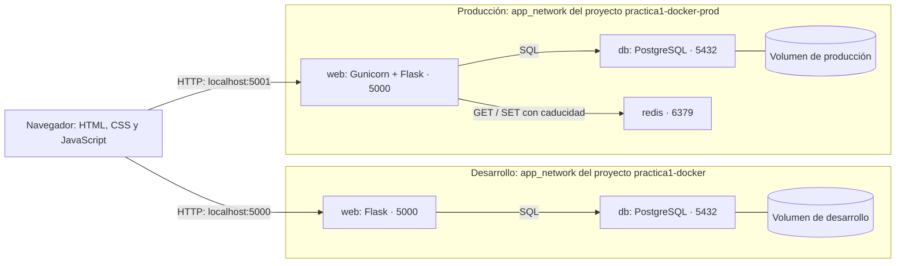

# Despliegue de aplicaciones multi-entorno con Docker

El objetivo de esta práctica es aprender a diseñar y desplegar un servicio
compuesto por varias aplicaciones interconectadas, distribuidas en contenedores
Docker. Para ello, se utiliza una web sobre la selección española de fútbol,
desarrollada con Flask y conectada a PostgreSQL, que incorpora Redis como caché
solo en producción.

El servicio se despliega en dos entornos diferenciados: desarrollo (`dev`) y
producción (`prod`). La práctica se centra en la orquestación de los servicios,
la configuración de cada entorno, la persistencia de los datos, la comunicación
mediante redes internas y la seguridad básica dentro del ecosistema Docker.

La idea de la web es permitir explorar las plantillas de la selección española de fútbol en distintos mundiales, consultar los convocados de cada edición, ver sus fichas y filtrarlos por posición. En esta práctica se ha implementado la plantilla del Mundial de 2026 como punto de partida. Además, la web muestra el estado de conexión de los servicios y el origen del listado —PostgreSQL o Redis— para visualizar el funcionamiento de la base de datos y la caché. La temática deportiva sirve como ejemplo práctico para demostrar la comunicación entre los contenedores y el comportamiento de la aplicación ante fallos.

Este README es la guía de instalación y demostración.

- [1. Instalación y ejecución](#1-guía-de-instalación-y-ejecución-paso-a-paso)
- [2. Entornos dev y prod](#2-descripción-de-los-entornos-dev-y-prod)
- [3. Arquitectura](#3-diagrama-de-arquitectura-del-servicio)
- [4. Pruebas y verificaciones](#4-resultados-de-las-pruebas-y-verificaciones)
- [5. Healthchecks](#5-explicación-de-los-healthchecks)
- [6. Makefile](#6-instrucciones-de-uso-del-makefile)
- [Declaración de IA y fuentes](#anexos)

## 1. Guía de instalación y ejecución paso a paso

### 1.1. Requisitos

- Docker Engine o Docker Desktop arrancado y accesible por el usuario.
- Plugin Docker Compose (`docker compose`) con soporte para `--wait` y `--wait-timeout`.
- Git, GNU Make y una terminal compatible con shell POSIX. La práctica se ha
  probado en Linux; en Windows se puede usar WSL con Docker disponible allí.
- Internet para clonar y descargar imágenes y dependencias en la primera construcción.

No es necesario instalar Python, PostgreSQL ni Redis en el host.

```bash
docker --version
docker compose version
make --version
```

### 1.2. Obtener el proyecto

```bash
git clone https://github.com/creyg11/practica1-docker.git
cd practica1-docker
```

Si se usa el ZIP de entrega, descomprimirlo y abrir una terminal en su carpeta raíz.
Los siguientes comandos se ejecutan siempre desde esa carpeta.

### 1.3. Crear la configuración local

```bash
make init ENV=dev
make init ENV=prod
```

Estos comandos copian las plantillas con permisos `600` y conservan cualquier
archivo existente. Editar `.env.dev` y `.env.prod` para sustituir
`POSTGRES_PASSWORD` por una contraseña propia **antes del primer arranque**.
Los `.env` reales no se incluyen en Git.

El Makefile selecciona el archivo mediante `--env-file`. Compose sustituye sus
variables en el YAML y el apartado `environment` las pasa a los contenedores
que las necesitan.

- `WEB_PORT`: puerto del host; cambiarlo si 5000 o 5001 están ocupados.
- `POSTGRES_DB`, `POSTGRES_USER`, `POSTGRES_PASSWORD`: base y credenciales iniciales.
- `REDIS_HOST=redis`, `REDIS_PORT=6379`: conexión interna de Flask en producción.
  No son puertos publicados en el host ni cambian el puerto de escucha de Redis.

```bash
make validate ENV=dev
make validate ENV=prod
```

### 1.4. Arrancar

```bash
make dev
make prod
```

Cada orden construye la imagen web y ejecuta Compose en segundo plano,
esperando a que los servicios estén saludables. Se pueden ejecutar los dos
entornos a la vez con sus puertos por defecto.

Abrir [desarrollo](http://localhost:5000) o [producción](http://localhost:5001).
Ambas direcciones redirigen a `/jugadores`.

```bash
make ps ENV=dev
make health ENV=dev
make ps ENV=prod
make health ENV=prod
```

Con el directorio de datos vacío, PostgreSQL crea la base y ejecuta `db/init/01-jugadores.sql`,
que crea la tabla e inserta 26 jugadores. Las fotos están incluidas en `app/static/`;
la base guarda sus rutas, no los archivos de imagen.

### 1.5. Terminar conservando los datos

```bash
make down ENV=dev
make down ENV=prod
```

Se eliminan los contenedores y la red de cada entorno; los volúmenes permanecen.
El próximo arranque reutiliza sus datos. `make stop` solo detiene los contenedores.

### 1.6. Cambios posteriores y resolución de problemas

Cambiar `POSTGRES_USER`, `POSTGRES_DB` o `POSTGRES_PASSWORD` en el `.env` no
modifica una base ya inicializada. Para cambiar una contraseña existente se
puede entrar con `make db ENV=prod` usando la actual, ejecutar `\password` y
actualizar después `.env.prod` con el mismo valor. Recrear los servicios con
`make prod` aplica las nuevas variables. No borrar el volumen para un cambio
normal de contraseña.

Los SQL de `db/init/` solo se ejecutan automáticamente con el directorio de
datos vacío. Editarlos no modifica una base existente: esos cambios deben
aplicarse mediante SQL. No usar `down -v` en la prueba de persistencia, porque
eliminaría el volumen y sus datos.

Si Docker indica que no puede conectar con el daemon, comprobar que esté
arrancado. Si indica `permission denied`, revisar los permisos de acceso a
Docker del usuario; no es un fallo de Flask. Si falla el arranque, consultar
`make ps ENV=prod` y `make logs ENV=prod SERVICE=web` (o `SERVICE=db`).

El código y los archivos estáticos se copian a la imagen web durante la
construcción. Después de modificarlos, ejecutar `make web-rebuild ENV=dev`
o `make web-rebuild ENV=prod`, con sus dependencias arrancadas. Desarrollo no
tiene recarga automática del código ni un montaje de la carpeta `app`.

## 2. Descripción de los entornos dev y prod

Desarrollo permite trabajar con Flask y PostgreSQL sin caché: cada carga del
listado consulta la base. Producción añade Redis para reutilizar resultados y
sustituye el servidor de desarrollo de Flask por Gunicorn, configurado con dos
procesos de trabajo. Ambos entornos ejecutan la misma aplicación.

| Configuración | Desarrollo | Producción |
| --- | --- | --- |
| Compose | `docker-compose.dev.yml` | `docker-compose.prod.yml` |
| Variables | `.env.dev` | `.env.prod` |
| Plantilla de variables | `.env.example` | `.env.prod.example` |
| Dockerfile de web | `app/Dockerfile` | `app/Dockerfile.prod` |
| Servidor | `python app.py` | Gunicorn, dos workers |
| Servicios | web, db | web, db, redis |
| URL por defecto | http://localhost:5000/jugadores | http://localhost:5001/jugadores |
| Base por defecto | `seleccion` | `seleccion_prod` |
| Volumen por defecto | `practica1-docker_postgres_data` | `practica1-docker-prod_postgres_data` |

Cada proyecto tiene su propia red y su propio volumen. El nombre de desarrollo
se deriva de la carpeta `practica1-docker`; producción fija su nombre en Compose.
`db:5432` y `redis:6379` son direcciones internas. Solo web publica un puerto,
vinculado a `127.0.0.1` del host para acceder desde ese mismo ordenador.

En producción, `app/Dockerfile.prod` arranca el servidor con:

```bash
gunicorn --bind 0.0.0.0:5000 --workers 2 --access-logfile - --error-logfile - app:app
```

Gunicorn recibe las peticiones HTTP y ejecuta la aplicación Flask. `app:app`
identifica el módulo `app.py` y su objeto `app`; las rutas y consultas siguen
en ese archivo. Los dos workers son procesos del mismo contenedor. Los logs
se envían a la salida del contenedor y se consultan con `make logs`.

### 2.1. Separación y seguridad de los entornos

- Las credenciales se leen de variables de entorno; los `.env` reales están
  ignorados por Git y se crean con permisos `600`. Solo se distribuyen plantillas.
- Solo web publica un puerto. Las redes son bridge privadas de cada proyecto;
  no se ha configurado `internal: true`, por lo que no se bloquea su salida a Internet.
- Web de producción se ejecuta con un usuario sin privilegios (UID 10001).
- El SQL inicial se monta en modo solo lectura. `.dockerignore` excluye archivos
  innecesarios del contexto de construcción de la web.

La configuración es para la práctica local. El usuario inicial de PostgreSQL
es superusuario y Redis no exige contraseña; su puerto no se publica en el host.

## 3. Diagrama de arquitectura del servicio

| Parte | Tecnología | Propósito en la práctica |
| --- | --- | --- |
| Frontend | HTML, CSS y JavaScript | Mostrar el equipo y actualizar los indicadores de conexión. |
| Backend | Python 3.11 y Flask | Consultar PostgreSQL y Redis, generar HTML y ofrecer `/health`. |
| Base de datos | PostgreSQL 17 | Guardar los datos y demostrar persistencia con un volumen. |
| Caché | Redis 7.4, solo en producción | Reutilizar el listado durante 30 segundos y reducir consultas a PostgreSQL. |
| Servidor de producción | Gunicorn | Ejecutar Flask con dos procesos de trabajo. |
| Orquestación | Docker Compose y Make | Construir, arrancar y gestionar los entornos de forma reproducible. |

### 3.1. Diagrama de comunicación



### 3.2. Flujo de una petición

Flask sirve las plantillas y los archivos estáticos desde `web`; el JavaScript
se ejecuta en el navegador. No necesitamos un contenedor adicional para el frontend.

Al cargar `/jugadores`, Flask consulta PostgreSQL directamente en desarrollo.
En producción busca primero `jugadores:v1` en Redis: si existe una copia válida,
la utiliza; si no, consulta PostgreSQL y guarda el resultado como JSON durante
30 segundos. Leer la copia no renueva su caducidad. Redis no consulta PostgreSQL
por sí mismo. Si Redis falla, Flask intenta consultar PostgreSQL directamente.

El panel de conexión funciona por separado: `estado.js` pide `/health` a Flask,
que comprueba PostgreSQL con `SELECT 1` y Redis con `PING` en producción. Por ello,
aunque el listado venga de caché, las comprobaciones de salud siguen consultando
PostgreSQL. El navegador nunca conecta directamente con PostgreSQL ni Redis.

`obtener_jugadores()` devuelve los datos, su origen y un mensaje sobre la caché.
La ruta los pasa a `jugadores.html` mediante `render_template()`. El origen y
el TTL mostrado describen esa carga de la página; `estado.js` solo actualiza
las conexiones. Las fotos son archivos estáticos de web: PostgreSQL y Redis
guardan sus rutas. La cabecera tiene una ruta fija en el HTML y sigue visible
aunque falle la base.

La base de datos y el volumen son conceptos diferentes: PostgreSQL gestiona
las tablas y guarda sus archivos en `/var/lib/postgresql/data`, montado sobre
el volumen `postgres_data` de cada proyecto. Al eliminar el contenedor se
conserva ese volumen. El montaje `./db/init:/docker-entrypoint-initdb.d:ro`
es distinto: comparte los SQL del host en modo solo lectura para inicializar
una base nueva; no impide escribir datos en PostgreSQL.

### 3.3. Correspondencia con los archivos del proyecto

| Archivo o carpeta | Contenido |
| --- | --- |
| `app/app.py` | Conexiones DB/Redis, consulta del listado, caché y `/health`. |
| `app/templates/jugadores.html` | HTML generado por Flask. |
| `app/static/` | CSS, JavaScript y fotografías servidos al navegador. |
| `app/Dockerfile` y `app/Dockerfile.prod` | Construcción de la web para cada entorno. |
| `db/init/01-jugadores.sql` | Tabla y datos iniciales. |
| `db/demo/` | Alta y baja del entrenador para la demostración. |
| `docker-compose.*.yml` | Servicios, redes, volúmenes y healthchecks. |
| `Makefile` | Comandos de despliegue y demostración. |
| `scripts/clean-project.sh` | Limpieza final de los recursos de ambos entornos. |
| `docs/evidencias/` | Capturas del ensayo incluidas en este README. |


## 4. Resultados de las pruebas y verificaciones

Las pruebas se realizaron el **16/10/2026**, partiendo de ambos entornos sin
contenedores, imágenes ni volúmenes. Los resultados proceden de la salida de
los comandos y de las comprobaciones manuales de la web durante el ensayo.
Las capturas de la prueba de persistencia se incluyen en el procedimiento.

### 4.1. Resultados obtenidos

| Verificación | Comandos y resultado observado |
| --- | --- |
| Limpieza inicial | `make clean-all` eliminó los cinco contenedores, las dos redes, los dos volúmenes y las imágenes de web, PostgreSQL y Redis. `docker ps -a`, `docker image ls` y `docker volume ls` quedaron vacíos; solo permanecieron las redes predeterminadas `bridge`, `host` y `none`. |
| Despliegue automatizado | `make dev` y `make prod` validaron Compose, construyeron web y crearon los recursos de cada entorno. Los dos contenedores de dev y los tres de prod terminaron `healthy`. La construcción reutilizó capas (`CACHED`); los volúmenes de datos eran nuevos. |
| Inicialización automática | `make players` en cada entorno devolvió los 26 jugadores iniciales, con IDs del 1 al 26 y sin entrenador. |
| Salud inicial | `make health` devolvió HTTP 200 en ambos entornos. Web y DB conectadas; caché `not_applicable` en dev y `connected` en prod. `make redis-ping ENV=prod` respondió `PONG`. |
| Separación de datos | `make volumes` mostró `practica1-docker_postgres_data` y `practica1-docker-prod_postgres_data`, ambos con escritura en `/var/lib/postgresql/data`. Los SQL iniciales estaban montados en modo solo lectura. |
| Redes y seguridad | `make networks` confirmó una red diferente por entorno. `make security ENV=prod` mostró `uid=10001(appuser)` y el puerto de web publicado en `127.0.0.1:5001`. |
| Alta del dato de prueba | `make coach-add ENV=prod` devolvió `INSERT 0 1`; la consulta directa mostró 27 filas, con el entrenador en el ID 27. Tras vaciar Redis, la web lo mostró con origen PostgreSQL. |
| Persistencia al eliminar el contenedor | `make db-remove ENV=prod` eliminó DB; `make ps ENV=prod` mostró solo web y Redis y `docker volume ls` confirmó que el volumen seguía existiendo. Tras `make db-start ENV=prod`, `make players ENV=prod` devolvió los 27 registros y el entrenador conservó el ID 27, sin volver a insertarlo. |
| Baja del dato de prueba | `make coach-remove ENV=prod` devolvió el entrenador con ID 27 y `DELETE 1`. `make players ENV=prod` confirmó que permanecían los 26 jugadores iniciales. |
| Contenido y caducidad de la caché | `make cache-show ENV=prod` mostró un JSON con los 26 jugadores: nombre, posición y ruta de imagen. `make cache-ttl ENV=prod` devolvió 21 segundos; tras esperar sin recargar, devolvió `-2` y `GET` no devolvió contenido. |
| Uso de Redis desde la web | Tras caducar la clave, la primera recarga mostró origen PostgreSQL y la siguiente recarga inmediata mostró Redis. |
| Caída de Redis | `make redis-stop ENV=prod` dejó `/health` en HTTP 503, con caché desconectada y web y DB conectadas. Al recargar, los jugadores siguieron disponibles con origen PostgreSQL. |
| Recuperación de Redis | `make redis-start ENV=prod` dejó Redis `healthy`; `make redis-ping ENV=prod` respondió `PONG` y `make health ENV=prod` volvió a HTTP 200 con los tres servicios conectados. |
| Caída de DB en desarrollo | `make db-stop ENV=dev` dejó `/health` en HTTP 503, con DB desconectada y caché `not_applicable`. Al recargar, apareció el aviso de error sin el listado. La imagen de cabecera siguió visible porque no depende de la consulta. |
| Recuperación de DB | `make db-start ENV=dev` dejó DB `healthy`; `make health ENV=dev` volvió a HTTP 200 y `make players ENV=dev` confirmó los 26 jugadores. |

La persistencia se demostró **conservando el volumen y eliminando el contenedor**.
La limpieza inicial, que borra los volúmenes, sirvió para comprobar la
inicialización automática. La caché de construcción de Docker es independiente
de los datos de PostgreSQL y de la caché del listado en Redis.

### 4.2. Procedimiento para repetir las pruebas

Los siguientes pasos describen cómo reproducir las comprobaciones y qué se
debe observar. No sustituyen el registro de resultados de la tabla anterior.

#### Conexión directa a PostgreSQL

```bash
make db ENV=prod
```

Introducir la contraseña de `.env.prod`. Dentro de `psql`:

```sql
SELECT 1;
SELECT COUNT(*) FROM jugadores;
```

La primera consulta devuelve `1`; la segunda, un conteo de `26` jugadores si
no está añadido el entrenador. Salir con `\q`.
Para desarrollo, usar `make db ENV=dev` y la contraseña de `.env.dev`.

#### Persistencia: añadir el entrenador, eliminar DB y recuperarla

Con producción arrancada, añadir un dato que no existe en el SQL inicial:

```bash
make coach-add ENV=prod
make players ENV=prod
make cache-clear ENV=prod
```

Recargar [la web de producción](http://localhost:5001/jugadores): aparece Luis de la Fuente Castillo
en «Cuerpo técnico». Anotar su ID.

Captura del ensayo del 16/10/2026, antes de eliminar el contenedor: la consulta
SQL mostró el ID 27 y la web mostró al entrenador con origen PostgreSQL.


Eliminar el contenedor y comprobar su ausencia:

```bash
make db-remove ENV=prod
make ps ENV=prod
docker volume ls
```

DB ya no debe aparecer, pero el volumen de producción debe seguir existiendo.

Crear el contenedor de nuevo y consultar directamente la base:

```bash
make db-start ENV=prod
make players ENV=prod
make cache-clear ENV=prod
```

El entrenador debe conservar sus datos y su ID. Recargar la web para verlo.

Resultado del ensayo del 16/10/2026: la consulta directa devolvió 27 filas y el
entrenador conservó el ID 27. Tras recrear DB, la web lo mostró con origen PostgreSQL.


Se vacía Redis para que una copia anterior no se confunda con persistencia.

Eliminar el dato de prueba:

```bash
make coach-remove ENV=prod
make players ENV=prod
make cache-clear ENV=prod
```

Recargar: desaparecen el entrenador y su grupo. La foto permanece en la imagen
web para repetir la prueba. Los SQL de `db/demo/` se ejecutan solo al invocar
estos comandos; no forman parte de la inicialización.

El ID es un identificador, no un contador de filas. Borrar una fila no reinicia
la secuencia, y un INSERT con conflicto puede consumir un número aunque no
inserte nada. Los huecos son normales. Reinsertar al entrenador genera otro ID;
recrear únicamente el contenedor conserva el existente.

#### Caché: PostgreSQL → Redis → PostgreSQL

```bash
make cache-clear ENV=prod
```

1. Recargar la web de producción: debe indicar **PostgreSQL** y copia guardada.
2. Recargar antes de 30 segundos: debe indicar **Redis**.
3. Consultar la copia y su tiempo restante:

   ```bash
   make cache-show ENV=prod
   make cache-ttl ENV=prod
   ```

4. Esperar más de 30 segundos sin recargar y repetir los dos comandos: `GET`
   no devuelve contenido y el TTL vale `-2`, siempre que otra petición no haya
   regenerado antes la copia.
5. Recargar: vuelve a **PostgreSQL**. Otra recarga inmediata muestra **Redis**.

El contador mostrado en la web es el tiempo que quedaba al cargar, no una
cuenta atrás en vivo. Leer Redis no reinicia los 30 segundos.

#### Fallo y recuperación de Redis

```bash
make redis-stop ENV=prod
make health ENV=prod
```

Esperar la actualización del panel: Redis aparece sin conexión y `/health`
devuelve HTTP 503. Al recargar, el listado sigue disponible desde PostgreSQL.

```bash
make redis-start ENV=prod
make redis-ping ENV=prod
make health ENV=prod
```

Se espera `PONG`, HTTP 200 y la recuperación automática del panel.

#### Fallo y recuperación de PostgreSQL sin caché

Abrir primero la web de desarrollo y ejecutar:

```bash
make db-stop ENV=dev
make health ENV=dev
```

El panel debe señalar la caída de PostgreSQL. Al recargar, el listado devuelve
HTTP 503 con un mensaje de error; los jugadores de una página ya abierta no
se borran solos. Recuperar y recargar:

```bash
make db-start ENV=dev
make health ENV=dev
make players ENV=dev
```

Se espera HTTP 200 y los 26 jugadores. El panel se recupera automáticamente;
recargar para volver a obtener el listado.

#### Redes, almacenamiento y seguridad

```bash
make networks ENV=dev
make networks ENV=prod
make volumes ENV=dev
make volumes ENV=prod
make security ENV=prod
```

Comprobar que web, db y redis comparten la red del entorno, que DB monta su
volumen y que web de producción usa UID 10001 y publica solo `127.0.0.1:5001`.
Redis no publica puerto ni usa un volumen persistente: tiene `/data` en `tmpfs`
y la persistencia RDB/AOF desactivada. Los datos duraderos pertenecen a PostgreSQL.
La ruta `Source` del volumen corresponde al host del daemon Docker; con Docker
Desktop puede estar dentro de su máquina virtual. No es necesario modificarla
manualmente.

## 5. Explicación de los healthchecks

### 5.1. Comprobación de cada contenedor

Todos los contenedores tienen un healthcheck configurado en su Compose:

| Servicio | Comprobación | Intervalo / timeout / reintentos / gracia inicial |
| --- | --- | --- |
| web, ambos entornos | Python pide `http://127.0.0.1:5000/health`; HTTP 200 indica éxito. | 10 s / 9 s / 3 / 15 s |
| db, ambos entornos | `pg_isready` comprueba si PostgreSQL acepta conexiones. | 5 s / 3 s / 5 / 10 s |
| redis, producción | `redis-cli ping` debe responder `PONG`. | 5 s / 3 s / 5 / 5 s |

- **Intervalo:** tiempo entre comprobaciones normales.
- **Timeout:** tiempo máximo permitido para ejecutar la comprobación.
- **Reintentos:** fallos consecutivos necesarios para marcar `unhealthy`.
- **Gracia inicial:** periodo de arranque durante el que los fallos no cuentan;
  una comprobación correcta puede marcar el servicio saludable antes de terminarlo.

La petición Python de web tiene un timeout de 8 segundos. `depends_on` espera
que DB —y Redis en producción— estén saludables antes de iniciar web. Esa
condición coordina el arranque; no detiene web si una dependencia falla después.
Un estado `unhealthy` no reinicia automáticamente el contenedor. La política
`restart: unless-stopped` de producción actúa cuando el proceso termina.

### 5.2. Respuesta del endpoint `/health`

`/health` comprueba una consulta real a PostgreSQL y un PING a Redis, sin leer
ni renovar la caché del listado. Devuelve HTTP 200 si las dependencias responden,
o HTTP 503 si alguna falla. Ejemplo de producción saludable:

```json
{"status":"healthy","services":{"web":"connected","db":"connected","cache":"connected"}}
```

En desarrollo, `cache` vale `not_applicable`.

`pg_isready` comprueba que el servidor acepta conexiones; `/health` comprueba
además que Flask puede autenticarse y ejecutar SQL. Un HTTP 503 de `/health`
indica un estado degradado: con Redis caído, `/jugadores` puede seguir
respondiendo correctamente desde PostgreSQL. Si web no responde, JavaScript
muestra su estado sin respuesta y las dependencias como desconocidas.

### 5.3. Actualización de la interfaz

`app/static/js/estado.js` consulta `/health` con `fetch()` y vuelve a comprobar
el estado 5 segundos después de terminar cada petición, mediante
`setTimeout(checkServices, 5000)`. El panel puede reflejar
el fallo antes que Docker, que espera sus reintentos. Los jugadores y el aviso
de origen se actualizan al recargar la página, no con el sondeo del panel.

Para consultar ambas comprobaciones desde la terminal:

```bash
make ps ENV=prod
make health ENV=prod
```

`ps` muestra el estado que mantiene Docker; `health` hace una petición nueva
a Flask. Pueden diferir temporalmente por los intervalos y reintentos de Docker.

## 6. Instrucciones de uso del Makefile

### 6.1. Selección del entorno y ayuda

**Por defecto se usa `ENV=dev`.** Ejecutar `make prod` no cambia ese valor para
órdenes posteriores: para consultar o modificar producción hay que indicar
`ENV=prod` en cada comando.

```bash
make help
make demo
```

`make demo` muestra el orden de la exposición; no ejecuta las operaciones.

### 6.2. Comandos disponibles

| Comando | Función |
| --- | --- |
| `make init ENV=prod` | Crear `.env.prod` desde su plantilla si no existe, con permisos `600`. |
| `make validate ENV=prod` | Validar Compose sin imprimir credenciales. |
| `make build ENV=prod` | Construir la imagen web. |
| `make dev` / `make prod` | Construir y arrancar cada entorno. |
| `make up ENV=prod` | Arrancar el entorno seleccionado con construcción. |
| `make stop ENV=prod` / `make down ENV=prod` | Detener / eliminar contenedores y red, conservando datos. |
| `make clean ENV=dev` / `make clean ENV=prod` | Eliminar contenedores, red e imagen propia de web del entorno indicado. Conservar el volumen con sus datos y las imágenes de PostgreSQL, Redis y Python. |
| `make clean-all` | Limpiar ambos entornos mediante `scripts/clean-project.sh`: contenedores, redes, volúmenes e imágenes de web, PostgreSQL, Redis y Python. **Borra los datos**; requiere ambos `.env`, sin `ENV`. Usar solo al terminar. No fuerza imágenes en uso; puede dejar caché de construcción e imágenes antiguas sin uso. |
| `make ps ENV=prod` / `make health ENV=prod` | Ver contenedores / consultar `/health` desde web. |
| `make logs ENV=prod SERVICE=web` | Seguir logs; Ctrl+C sale de los logs sin detener el servicio. |
| `make web-rebuild ENV=prod` | Reconstruir y recrear solo web; requiere DB y Redis arrancados. |
| `make db ENV=prod` | Entrar en psql por TCP; pide contraseña. Salir con `\q`. |
| `make players ENV=prod` | Consultar el listado directamente en PostgreSQL, sin Redis. |
| `make coach-add ENV=prod` / `make coach-remove ENV=prod` | Añadir / borrar el entrenador de prueba. |
| `make db-stop ENV=prod` / `make db-start ENV=prod` | Detener / arrancar PostgreSQL. |
| `make db-remove ENV=prod` / `make db-recreate ENV=prod` | Eliminar / recrear su contenedor conservando el volumen. |
| `make networks ENV=prod` / `make volumes ENV=prod` | Inspeccionar redes y montajes, incluida la ruta del volumen en el host Docker. |
| `make images ENV=prod` / `make security ENV=prod` | Ver imágenes / usuario de web y puerto publicado. |
| `make redis ENV=prod` / `make redis-ping ENV=prod` | Abrir redis-cli / comprobar PONG. Salir de redis-cli con `exit`. |
| `make redis-stop ENV=prod` / `make redis-start ENV=prod` | Detener / arrancar Redis. |
| `make cache-show ENV=prod` / `make cache-ttl ENV=prod` | Mostrar el JSON / segundos restantes (`-2`: clave ausente). |
| `make cache-clear ENV=prod` | Borrar solo `jugadores:v1`, sin tocar PostgreSQL. |

Los comandos comunes aceptan también `ENV=dev`; los de Redis y caché requieren
`ENV=prod`. `make health` termina con error si recibe HTTP 503: es el resultado
esperado durante una prueba de fallo, y muestra el JSON para identificarlo.

### 6.3. Relación entre Make y Docker Compose

Make abrevia los comandos; los servicios siguen definidos en los archivos
Compose. Por ejemplo:

```bash
make up ENV=prod
```

Primero valida la configuración y después ejecuta:

```bash
docker compose --env-file .env.prod -f docker-compose.prod.yml up --build -d --wait --wait-timeout 120
```

`--build` construye las imágenes necesarias, `-d` deja los servicios en segundo
plano y `--wait` espera a que estén preparados. `make build ENV=prod` permite
construir solo la imagen web sin arrancar servicios. `make down ENV=prod`
elimina los contenedores y la red de producción sin borrar su volumen.

## Anexos

### A. Declaración de uso de inteligencia artificial

Los modelos de la tabla son los indicados por el autor el 16/10/2026.

| Herramienta y modelo declarado | Finalidad | Partes del trabajo |
| --- | --- | --- |
| OpenAI Codex — Astra, razonamiento High | Asistencia en implementación, explicación de conceptos, revisión y comprobaciones. | Flask (app.py), healthchecks, Makefile y documentación. |
| Google Antigravity — Claude Sonnet 4.6 | Completar la plantilla y adaptar las fotografías. | SQL con los 26 jugadores, fotos de FIFA, ajuste CSS y textos de la interfaz. |
| Google Stitch — Gemini 3.8 Flash | Generar una propuesta visual inicial a partir de la cual adaptar la web. | Diseño HTML inicial, composición visual y referencia de cabecera. |
| ChatGPT — modelo no registrado | Apoyo para elegir tecnologías y entender Docker, PostgreSQL y la arquitectura. | Planificación y explicaciones durante el desarrollo. |

Los archivos `docker-compose.dev.yml`, `docker-compose.prod.yml`, `Dockerfile`
y `Dockerfile.prod` fueron redactados  a partir de los contenidos y ejemplos
explicados en clase, con las herramientas de IA empleadas únicamente como referencia de documentación oficial.

He utilizado estas herramientas como apoyo didáctico para resolver dudas,
comprender los conceptos y desarrollar la práctica paso a paso. He revisado
el código y la configuración, adaptando las propuestas a los requisitos del
proyecto y asegurándome de entender su funcionamiento. Las comprobaciones
realizadas se recogen en el apartado de pruebas y verificaciones. Este proceso
me ha permitido entender las decisiones tomadas y preparar su explicación
durante la presentación.

Aunque he contado con el apoyo de herramientas de IA, asumo la responsabilidad
del contenido, las decisiones y el funcionamiento de la práctica realizada.

### B. Fuentes

- [Docker Hub](https://hub.docker.com/): registro de las imágenes base utilizadas.
- [FIFA: plantilla de España](https://www.fifa.com/es/tournaments/mens/worldcup/canadamexicousa2026/teams/spain/squad): referencia de nombres y fotografías de jugadores y entrenador utilizadas en la práctica.
- Diseño inicial exportado de Stitch y adaptado a plantillas Flask y CSS local.
